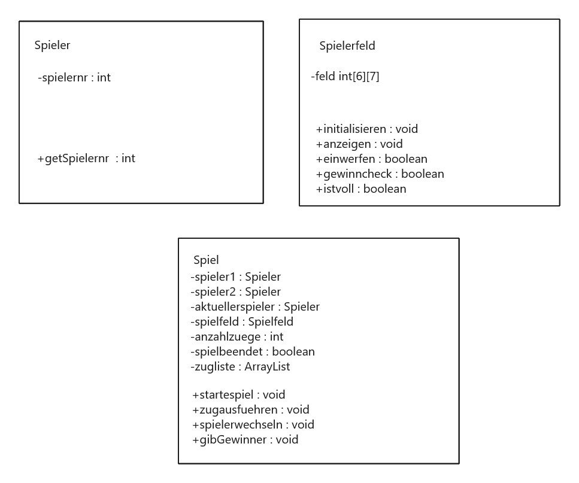

# Aufgabe: Vier gewinnt

## Spielregeln

- Gespielt wird zu zweit auf einem Feld mit 6 Zeilen und 7 Spalten.
- Pro Zug wirft ein Spieler einen Stein in eine Spalte, der Stein fällt nach unten.
- Wer zuerst vier Steine waagerecht, senkrecht oder diagonal hat, gewinnt.
- Ist das Feld voll und niemand hat vier in einer Reihe, endet das Spiel unentschieden.

## Klassendiagramm



### Spieler

```text
-spielernr : int
+getSpielernr : int
```

### Spielerfeld

```text
-feld : int[6][7]
+initialisieren : void
+anzeigen : void
+einwerfen : boolean
+gewinncheck : boolean
+istvoll : boolean
```

### Spiel

```text
-spieler1 : Spieler
-spieler2 : Spieler
-aktuellerspieler : Spieler
-spielfeld : Spielfeld
-anzahlzuege : int
-spielbeendet : boolean
-zugliste : ArrayList
+startespiel : void
+zugausfuehren : void
+spielerwecheln : void
+gibGewinner : void
```

## Hinweise

- Im Diagramm heißt die Feld-Klasse `Spielerfeld`, im Code `Spielfeld`.
- Im Diagramm steht `spielerwecheln`, im Code heißt die Methode `spielerwechseln`.
- Die Parameter der Methoden stehen nicht im Diagramm.
